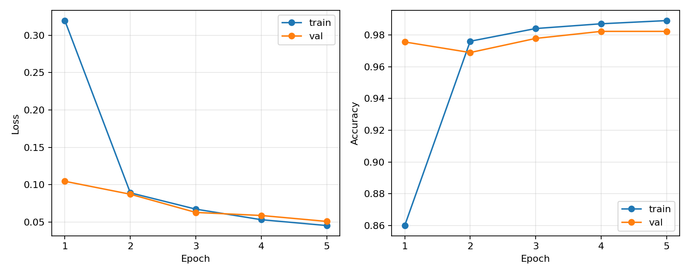
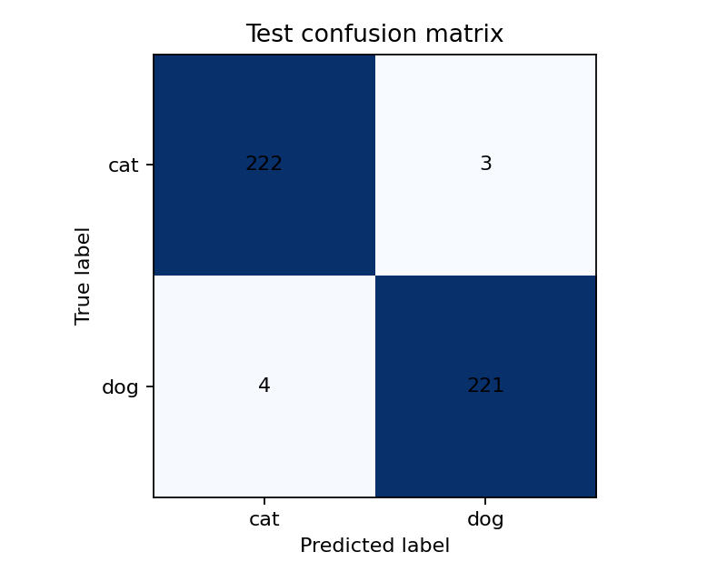
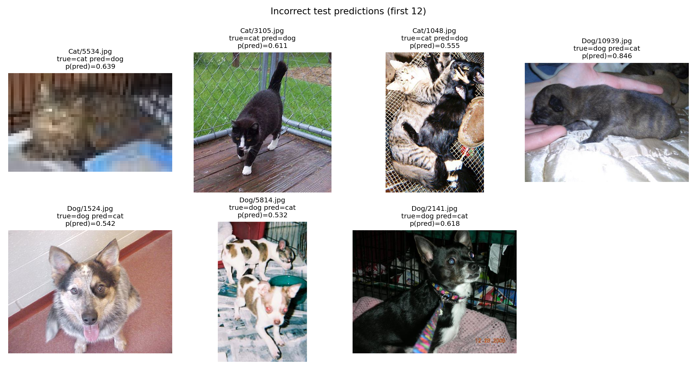

# 基于预训练 ResNet18 的猫狗图像分类与错误分析

使用 PyTorch 和 torchvision 官方 ImageNet 预训练 ResNet18 完成猫狗二分类。冻结主干，仅训练分类层，包含图片清洗、固定划分、训练验证、独立测试、模型保存加载和误分类分析。

## 实验结果

| 指标 | 实际结果 |
|---|---|
| 训练 / 验证 / 测试 | 1000 / 450 / 450 张，各类别均衡 |
| 可训练参数 | 1026，仅 `Linear(512, 2)` |
| 训练轮次 / 耗时 | 5 轮 / 约 20.69 秒，不含权重下载和初始化 |
| 最佳轮次 / 验证准确率 | 第 4 轮 / 98.22%（442/450） |
| 独立测试准确率 | **98.44%（443/450）** |
| 测试交叉熵损失 | 0.05253 |

混淆矩阵行表示真实类别，列表示预测类别：

| 真实 / 预测 | 猫 | 狗 |
|---|---:|---:|
| 猫 | 222 | 3 |
| 狗 | 4 | 221 |





## 方法

- 权重：`ResNet18_Weights.IMAGENET1K_V1`；冻结全部主干参数，替换二分类层。
- BatchNorm：训练时主干保持 `eval()`，固定运行统计量；分类层保持 `train()`。训练后核对主干参数及 buffer 未变。
- 预处理：EXIF 方向处理、RGB 转换、官方 `weights.transforms()`，短边缩放 256、中心裁剪 224、ImageNet 标准化。所有集合采用相同预处理，无随机增强。
- 配置：种子 42，CrossEntropyLoss 直接接收 logits，Adam，学习率 0.001，batch size 32，5 轮，训练循环预算 20 分钟。
- 模型选择：只根据验证准确率保存最佳权重，并列取较早轮次；重新加载后进行独立测试，测试后未调参。

## 数据与复现划分

来源：[微软 Kaggle Cats and Dogs Dataset](https://www.microsoft.com/en-us/download/details.aspx?id=54765)。数据集许可和原始说明见 [docs/DATA_LICENSE.pdf](docs/DATA_LICENSE.pdf) 与 [docs/DATA_README.txt](docs/DATA_README.txt)。仓库不包含原始数据集，案例图保留用于实验分析。

原始猫狗各 12500 张。完整解码检查后排除 3 张异常图、26 张同类重复图及 6 张跨类别像素相同但标签冲突的图片。按处理 EXIF 后的 RGB 像素及尺寸计算 SHA256，不检查近似图片。

固定种子 42，先每类抽样 1500 张，划分训练 1050、验证 225、测试 225。为缩短训练，从原随机训练列表每类保留前 500 张；验证和测试保持不变。最终实际使用 **1900 张**。正式清单及清洗记录保存在 `data/splits/`，类别为 `cat=0, dog=1`。

## 环境

实测：WSL2、Python 3.10.21、PyTorch 2.7.1+cu128、torchvision 0.22.1+cu128、RTX 5070 Laptop GPU（7.96 GiB）。其余依赖见 [requirements.txt](requirements.txt)。已有可用的 `d2l` 环境可直接复用。

新环境可按以下版本安装：

```bash
conda create -n cats-dogs python=3.10 -y
conda activate cats-dogs
python -m pip install torch==2.7.1 torchvision==0.22.1 --index-url https://download.pytorch.org/whl/cu128
python -m pip install -r requirements.txt
```

CUDA 运行需要兼容的 NVIDIA 驱动；跨软件或硬件版本不保证逐位复现。

## 使用已训练模型

仓库包含完整最佳权重 `outputs/best.pt`，加载时无须重新下载 ImageNet 权重。对自己的图片预测：

```bash
python predict.py /path/to/image.jpg
# 无 GPU 时：
python predict.py /path/to/image.jpg --device cpu
```

程序输出猫狗两类 Softmax 概率。概率未经校准；输入其他类别时也会被强制分为猫或狗。

## 从数据开始运行

在项目根目录执行。将微软原压缩包下载为 `data/raw/kagglecatsanddogs_5340.zip`：

```bash
mkdir -p data/raw
unzip -q data/raw/kagglecatsanddogs_5340.zip -d data/raw
python check_env.py
python prepare_data.py
```

仓库已包含实际实验结果。重新训练前先备份 `outputs/`，脚本会阻止覆盖已有结果：

```bash
mv outputs outputs_reference
python train.py
python evaluate.py
```

训练和测试默认使用 CUDA；仅显存不足时可用 `python train.py --batch-size 16`，需如实记录配置变更。首次训练联网下载官方预训练权重。评估也支持 `python evaluate.py --device cpu`。

## 错误分析

全部 7 个错误见 [errors.csv](outputs/test/errors.csv)：

- `Cat/5534.jpg` 明显模糊，视觉细节缺失。
- `Cat/1048.jpg` 猫狗同时出现，单标签未完整描述场景。
- `Dog/10939.jpg` 是部分被手遮挡的侧卧幼犬，被判猫的概率约 84.6%，说明高概率也可能出错。
- 其余案例包含多只动物、较暗场景等现象；部分错误仅靠原图无法解释。

以上为观察与可能原因，未进行因果验证。案例展示原图，实际输入为中心裁剪后的图像。完整讨论见 [实验报告](report.md)。



## 文件说明

```text
check_env.py          依赖及实际 GPU 运算检查
prepare_data.py       清洗、去重、抽样和划分
project_utils.py      共用的数据读取、模型构建和加载
train.py              训练、验证选模、曲线及权重保存
evaluate.py           独立测试、逐张预测和案例图
predict.py            单图预测
requirements.txt     实测依赖版本
report.md            一页篇幅实验报告
docs/                原始数据许可及说明
data/splits/         正式数据清单、类别映射及清洗记录
outputs/             最佳权重、配置、训练日志及曲线
outputs/test/        指标、全部预测、混淆矩阵及案例图
```

`training_summary.json` 的 `test_evaluated=false` 是训练结束时的历史状态，最终测试以 `outputs/test/metrics.json` 为准。后者记录测试清单与权重 SHA256，可核对结果对应的数据和模型。

## 局限与工作说明

单模型、单种子、小规模同源数据划分，无外部数据测试或算法对比。像素去重不能排除近似图和相同动物身份，未核实与 ImageNet 的图片重叠；本次准确率不等于真实场景可靠率。

本项目为预训练模型迁移学习基础实践，不主张算法创新。代码使用 AI 辅助编写，项目作者在本机执行数据处理、GPU 检查、训练及独立测试。
